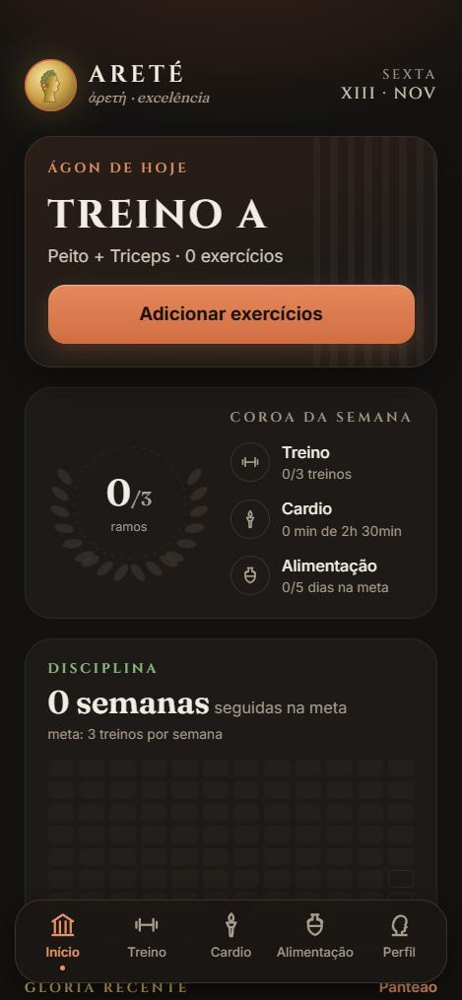
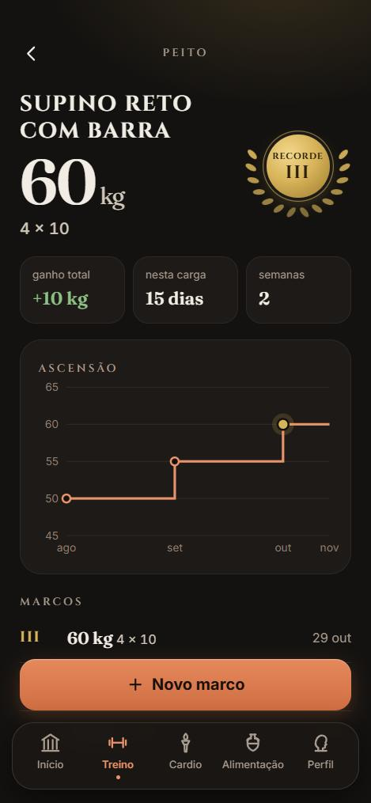
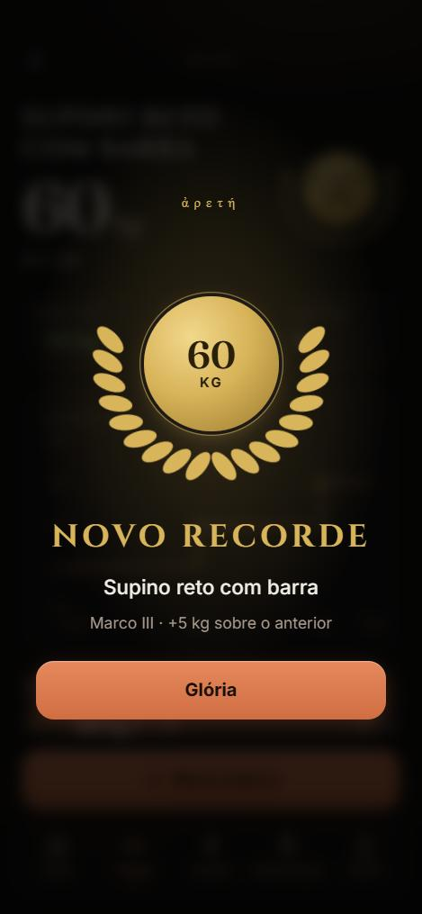
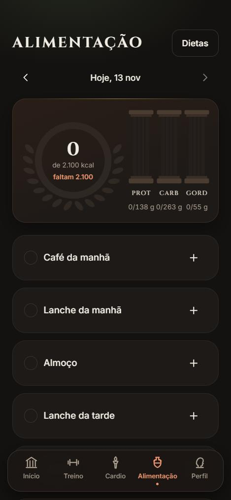

<div align="center">


# ARETÉ

***ἀρετή*** — a excelência alcançada pela prática constante.

Progressão de carga, cardio e alimentação num PWA feito para a academia.

[](https://github.com/mateusnchaves/Aret-/actions/workflows/ci.yml)


**[Abrir o app →](https://aret-one.vercel.app)** · [Especificação](SPEC.md) · [English](#english)

<br />

&nbsp;
&nbsp;
&nbsp;


</div>

---

## A ideia

A maioria dos apps de treino pede para marcar cada série. Na prática, ninguém quer abrir o celular entre uma série e outra. O Areté parte de outra pergunta: **quando foi a última vez que a carga subiu?**

Você registra só quando algo muda (a carga, as séries ou as repetições). A partir disso o app mostra a evolução de cada exercício, há quanto tempo você está parado em cada carga e quais exercícios pedem atenção. Cardio e alimentação entram no mesmo lugar, e a semana vira uma meta só.

## O que tem

### Treino
- **Fichas** (Treino A, B, C…) com exercícios do catálogo ou próprios, e rodízio automático do próximo treino.
- **Check-in** de um toque: o treino feito conta para a sequência e para a estagnação.
- **Progressão por exercício** com gráfico em degraus, ganho total, tempo na carga atual e histórico de marcos em numerais romanos.
- **Alerta de estagnação**: o exercício é destacado depois de N treinos sem evolução (padrão 6, ajustável).
- **Novo recorde**: ao superar a melhor carga, uma tela de glória com coroa de louros e vibração.
- **Panteão**: a maior carga de cada exercício, em medalhas, agrupadas por grupo muscular.

### Cardio
- Registro de esteira, bike, corrida e outros, com **calorias estimadas por MET** a partir do seu peso.
- **Meta semanal** em minutos ou calorias, com a semana dia a dia.

### Alimentação
- **Diário** por refeição, com a **tabela TACO** (591 alimentos brasileiros) e alimentos próprios.
- **Dietas**: monte a da nutricionista e marque a refeição como feita com um toque.
- **Meta diária** calculada (Mifflin-St Jeor + nível de atividade + objetivo) ou definida à mão.
- Anel de calorias e colunas de proteína, carboidrato e gordura que enchem ao longo do dia.

### Disciplina e glória
- **Coroa da semana**: três ramos (treino, cardio e alimentação). Com os três, a coroa fica dourada.
- **Sequência de semanas** na meta de treinos, com recorde e grade de constância de 12 semanas.
- **Máxima do dia**: Aristóteles, Epicteto, Sêneca e Marco Aurélio, com a fonte citada.

## Visual

O Areté não usa um tema genérico de app fitness. A identidade vem da Grécia antiga, com papéis claros para cada cor:

| Cor | Papel |
|---|---|
| Terracota | ação e marca: botões, aba ativa |
| Verde-louro | disciplina: o que foi feito, a sequência |
| Ouro | glória: recordes, medalhas, a coroa completa |

Os títulos usam Cinzel, inspirada em inscrições romanas. O texto corrido usa Fraunces e Inter. O ícone é uma **tetradracma**, a moeda ateniense, com um perfil laureado. Tudo respeita *reduzir movimento*.

## Stack

| Camada | Tecnologia |
|---|---|
| Interface | React 19, TypeScript (strict), Tailwind CSS 4, React Router, Recharts |
| Dados | TanStack Query, Supabase JS |
| Backend | Supabase: Postgres, Row Level Security, Auth (e-mail e Google) |
| PWA | vite-plugin-pwa (Workbox), instalável no Android e no iOS |
| Qualidade | Vitest, oxlint, `tsc`, GitHub Actions |
| Deploy | Vercel |

## Decisões

- **Registro por mudança, não por série.** Cada linha de `load_entries` é uma mudança de carga ou de séries × reps. "Parado há X" conta a partir da última mudança.
- **Histórico global por exercício.** O supino tem um gráfico só, venha de qualquer ficha.
- **Estagnação por treinos, não por dias.** Uma semana sem academia não deve marcar todos os exercícios como estagnados. Sem check-ins registrados, a regra cai para 28 dias.
- **A semana atual não quebra a sequência.** Ela só conta quando fecha; até lá, a sequência mostra o que já foi conquistado.
- **Online para gravar, cache para consultar.** O service worker guarda as leituras do Supabase (network-first), então dá para ver suas cargas sem sinal na academia.
- **RLS em tudo.** Cada usuário só lê e escreve as próprias linhas. O catálogo de exercícios e a TACO (`user_id` nulo) são só leitura.
- **Regras puras e testadas.** Estagnação, calorias por MET, meta calórica, sequência, coroa e recordes ficam em [`src/lib`](src/lib) como funções puras, com testes no Vitest.

## Estrutura

```
src/
├─ routes/        telas (Início, Treino, Progressão, Panteão, Cardio, Alimentação, Perfil)
├─ features/      componentes e hooks por domínio (training, cardio, nutrition, glory, auth)
├─ components/    layout, marca (moeda, louros, meandro) e UI base
└─ lib/           regras puras + testes, acesso ao Supabase, datas e formatação
supabase/migrations/   schema, RLS, catálogo de exercícios e tabela TACO
scripts/               gerador da migration da TACO
```

## Rodando localmente

Pré-requisitos: Node 24+ e um projeto no [Supabase](https://supabase.com) (o plano gratuito basta).

```bash
npm install
cp .env.example .env.local   # preencha a URL e a chave publicável
npm run dev
```

### Banco de dados

O schema, as políticas de RLS, o catálogo de exercícios e a TACO estão versionados em [`supabase/migrations`](supabase/migrations):

```bash
npx supabase login
npx supabase link --project-ref SEU_PROJECT_REF
npx supabase db push --remote
```

### Login com Google (opcional)

No painel do Supabase, em **Authentication → Sign In / Providers → Google**, informe o Client ID e o Secret criados no Google Cloud Console. Em **Authentication → URL Configuration**, adicione `http://localhost:5173` e a URL de produção às Redirect URLs. Depois, ligue `VITE_AUTH_GOOGLE_ENABLED=true`.

### Deploy (Vercel)

1. Importe o repositório na [Vercel](https://vercel.com/new). O [`vercel.json`](vercel.json) já define as rotas da SPA e os headers do service worker.
2. Em **Environment Variables**, adicione `VITE_SUPABASE_URL`, `VITE_SUPABASE_PUBLISHABLE_KEY` e, se usar Google, `VITE_AUTH_GOOGLE_ENABLED=true`.
3. No Supabase, troque a **Site URL** pela URL da Vercel e mantenha `http://localhost:5173` nas Redirect URLs.

### Scripts

| Comando | O que faz |
|---|---|
| `npm run dev` | servidor de desenvolvimento |
| `npm run build` | typecheck + build de produção (com service worker) |
| `npm run check` | lint + typecheck + testes (o mesmo que a CI roda) |
| `npm test` | testes das regras de cálculo |

## Roadmap

| Fase | Escopo | Status |
|---|---|---|
| 1 | Treino: fichas, histórico de carga, check-in, estagnação, progressão | ✅ |
| 2 | Cardio: registro, calorias por MET, meta semanal | ✅ |
| 3 | Alimentação: dietas, diário, macros com a tabela TACO | ✅ |
| — | Visual 2.0: coroa da semana, disciplina, recordes, Panteão, novo ícone | ✅ |
| 4 | IA (Gemini): lançar refeição em texto livre e importar dieta | ⏳ |

## Créditos

- Valores nutricionais da **TACO**: NEPA – UNICAMP. *Tabela brasileira de composição de alimentos*. 4. ed. rev. e ampl. Campinas: NEPA-UNICAMP, 2011. CSVs obtidos de [raulfdm/taco-api](https://github.com/raulfdm/taco-api); a migration é gerada por [`scripts/taco-to-sql.mjs`](scripts/taco-to-sql.mjs).
- Gasto calórico por atividade baseado nos valores MET do *Compendium of Physical Activities*.
- Fontes [Cinzel](https://fonts.google.com/specimen/Cinzel), [Fraunces](https://fonts.google.com/specimen/Fraunces) e [Inter](https://fonts.google.com/specimen/Inter), via Google Fonts.

---

## English

**Areté** (ἀρετή, "excellence") is a personal PWA for **strength progression**, **cardio** and **nutrition**.

Instead of logging every set, you only record when something changes. Areté then shows how each lift is progressing, how long you've been stuck at a load, and which exercises need attention. It also covers cardio with MET-based calorie estimates and a weekly goal, plus a nutrition diary built on the Brazilian TACO food table.

The design draws on ancient Greece. Terracotta marks actions, laurel green marks discipline and gold marks glory. Hitting all three weekly goals turns the *weekly crown* gold, and every new personal record gets its own laurel-wreath screen and a place in the *Pantheon*.

- **Live app:** [aret-one.vercel.app](https://aret-one.vercel.app) (the interface is in Portuguese)
- **Stack:** React 19, TypeScript, Tailwind CSS 4, TanStack Query, React Router, Recharts, vite-plugin-pwa, Supabase (Postgres + RLS + Auth), Vitest, oxlint, GitHub Actions, Vercel.
- **Run locally:** `npm install`, copy `.env.example` to `.env.local` with your Supabase URL and publishable key, apply the migrations with `npx supabase db push --remote`, then `npm run dev`.
- **Roadmap:** training, cardio, nutrition and the visual overhaul are done. Next up: AI meal logging with Gemini. Full spec (Portuguese) in [`SPEC.md`](SPEC.md).
